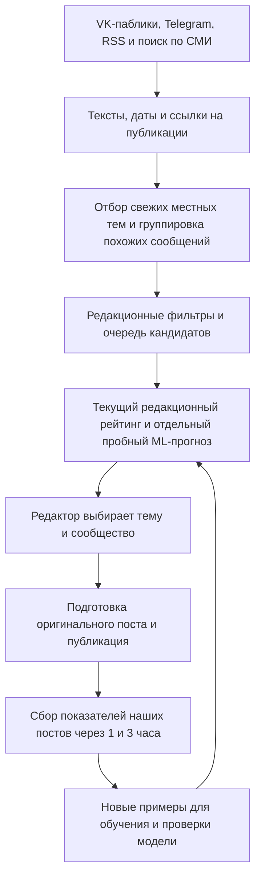

# Редакционный процесс проекта «Омск News Live»

Этот документ описывает, как проект находит темы, оценивает их для «Голоса Омска» и «Жести Омска» и помогает подготовить пост. Цель — быстро замечать интересные местные истории и выбирать их по тому, как публикации работают у нашей аудитории.

## Главный принцип

Посты сторонних пабликов, Telegram-каналов и СМИ нужны, чтобы **обнаружить тему и понять, что о ней сообщают**. Их просмотры, лайки, комментарии и репосты проект не использует для обучения модели и не считает показателями нашей аудитории.

Модель учится на собственных публикациях двух сообществ:

- «Голос Омска»;
- «Новости Омска | Жесть».

Так мы постепенно узнаём, какие темы и форматы лучше работают именно у наших читателей.

## Схема работы

## 1. Откуда берутся темы

Проект собирает публикации из отслеживаемых VK-пабликов, настроенных Telegram-каналов и добавленных RSS/Atom-лент. В список Telegram входят три закрытых канала, доступ к которым настроен в авторизованной сессии:

- «Омск Live» — канал ID `-1001178109741`;
- «Инцидент Омск!» — канал ID `-1001432513803`;
- «О чём говорят в Омске» — канал ID `-1001587149148`.

Остальные адреса и настройки находятся в `runtime/external_sources.json` и описаны в [docs/EXTERNAL_SOURCES.md](docs/EXTERNAL_SOURCES.md). Доступ к закрытым каналам зависит от членства подключённого Telegram-аккаунта.

Сборщик сохраняет текст, время публикации, источник, ссылку и тип вложения. Счётчики внешних публикаций не используются для рейтинга и обучения. Поиск в браузере и на сайтах СМИ можно использовать вручную. Автоматически проект читает только подключённые ленты; он не обходит поисковую выдачу браузера как отдельный источник.

## 2. Как работает сбор

Основной монитор обновляет публикации из отслеживаемых VK-пабликов и внешних источников примерно раз в пять минут. Он ограничивает рабочий пул публикациями за текущую дату по Омску и отбрасывает уже встречавшиеся сообщения.

Похожие публикации объединяются в одну тему. Так несколько сообщений об одном происшествии становятся одним кандидатом, а не несколькими новостями. Число источников помогает понять, что тема распространяется, но охваты и реакции чужих аудиторий не подменяют статистику наших сообществ.

Результаты этапов хранятся в папке `runtime/`, включая `editor_queue.json`, `predictor_queue.json` и `editorial_pool.json`. Это рабочие данные, а не готовые публикации.

## 3. Как выбирается приоритет

В очереди есть один основной рейтинг — `prediction.priority_score` от 0 до 100. Он помогает расставить кандидатов по редакционному приоритету. Это не вероятность вирусности и не гарантия будущего охвата.

Сейчас очередь использует действующий редакционный расчёт `editorial_v2`. Он учитывает свежесть, местную значимость, масштаб события и доступные сигналы темы. Отсутствующие внешние счётчики не следует считать нулевой реакцией аудитории.

Статусы очереди:

- `take_now` — кандидат попал в рабочую очередь;
- `reject` — кандидат исключён фильтром или не прошёл текущий порог приоритета.

Редактор решает, подходит ли тема «Голосу Омска», «Жести Омска» или обоим сообществам. Очередь помогает с отбором, но не публикует посты автоматически.

## 4. Что именно делает ML-модель

Трекер отдельно следит за новыми постами «Голоса Омска» и «Жести Омска». Примерно раз в минуту он проверяет публикации и сохраняет доступные показатели наших постов: просмотры, лайки, комментарии и репосты. Для каждого поста запланированы контрольные точки через 1 и 3 часа после публикации.

Целевая метрика для обучения учитывает реакции разного типа:

`(лайки + 2 × комментарии + 4 × репосты) / просмотры`.

На её значение в 1 и 3 часа обучаются модели для каждого горизонта и, когда хватает данных, для каждой аудитории. Для прогноза используются признаки темы: текст, время публикации и тематические группы. Сторонние просмотры и реакции в обучающие примеры не входят.

Для обучения нужно не менее 30 завершённых замеров. Пока данных недостаточно, прогноз может отсутствовать; тогда остаётся действующий редакционный расчёт. Новые замеры добавляются по мере публикаций, модели обновляются автоматически.

Сейчас ML-прогноз работает в **пробном режиме**: `predicted_engagement_1h`, `predicted_engagement_3h` и прогнозы для `golos` / `zhest` записываются отдельно, но не меняют основной `priority_score`. При выдаче кандидатов:

- показывать редакционный рейтинг и ML-прогноз как разные показатели;
- указывать горизонт и число обучающих примеров, если они доступны;
- не обещать точный результат и не выдавать пробный прогноз за итоговый рейтинг;
- если прогноза нет, говорить, что данных пока недостаточно.

Чтобы перевести ML из пробного режима в основной, сравнивать прогнозы с результатами новых постов отдельно для «Голоса» и «Жести», на данных, которые модель не использовала при обучении. Решение принимается после устойчивой проверки, а не по одному удачному прогнозу.

## 5. Редакторский отбор и честная подача

Скорость и эмоциональная сила темы важны. Для раннего отбора не нужно ждать официального подтверждения и не нужно подтверждать каждый пост несколькими СМИ. Нужно понять, кто и что именно сообщил, когда это произошло, и сохранить правильную атрибуцию.

Используй формулировки по ситуации: «по словам очевидцев», «сообщает канал…», «по данным издания…», «информация пока неофициальная, детали уточняются». Не превращай сообщение паблика или свидетеля в утверждение редакции. Особенно осторожно формулируй сведения о пострадавших, преступлениях, виновниках и причинах происшествия.

В очередь не должны попадать явная реклама и дубли. Применяются технические фильтры проекта, в том числе для отдельных исключённых тематик. Если важное событие развивается, к нему можно вернуться с указанием нового развития. Не отбрасывай сильный ранний сигнал только из-за отсутствия официального комментария.

Перед текстом достаточно открыть исходную публикацию, если она доступна, и сверить дату, контекст и формулировку. Дополнительные источники полезны, когда быстро доступны, но не должны задерживать раннее обнаружение. Если исходный материал недоступен, не утверждай, что он проверен, и обозначь источник информации.

## 6. Подготовка готового поста

Если пользователь просит найти кандидатов, по умолчанию предложи три наиболее подходящие свежие темы; если он указал другое число, соблюдай его. Для каждой темы укажи рекомендуемое сообщество — «Голос», «Жесть» или оба, затем дай готовый текст и отдельную ссылку для проверки источника.

Не показывай в обычном ответе редакционные баллы, ML-прогнозы, число обучающих примеров, таблицы и пояснения внутренних расчётов. Используй эти данные для отбора. Показывай их отдельно, только если пользователь прямо попросил объяснить прогноз или рейтинг.

Текст должен быть живым и понятным, а не выглядеть как сухая сводка. Начинай с конкретного цепкого заголовка и важных подробностей. Пересказывай своими словами, сохраняя смысл и атрибуцию. Не копируй чужие формулировки. Эмоциональную подачу и интригу используй уместно и не в каждом посте. Не добавляй факты, которых нет в источнике, и не удлиняй текст пустыми фразами.

Оформляй пост по образцу пользователя: жирный заголовок, отдельные абзацы. Название источника указывай отдельной строкой после основного текста и перед вопросом, в кавычках: «Город55». Если вопрос не нужен, поставь источник в конце поста. Ссылку для проверки дай после готового текста, отдельно от текста публикации.

Вопрос добавляй, только если он естественно продолжает тему. Оформляй отдельной строкой: эмодзи ❓ в начале и жирный текст вопроса без знака вопроса в конце, например: ❓**Как считаете, справедливое наказание за такую трагедию**. Используй обычный эмодзи, не превращай его в ссылку. Не оставляй внутренних пометок для редактора.
## 7. История тем

Перед подборкой сверяй кандидатов с `PUBLISHED_TOPICS.json` и доступной историей сообщества, чтобы не предлагать повтор опубликованной темы. Сам сборщик не заменяет эту редакторскую проверку.

Обновляй реестр по таким правилам:

- Когда пользователь сообщает «Было» или «Было: …», добавь тему в реестр со статусом `published`.
- Статус `rejected` используй самостоятельно для тем, которые следует исключать по редакционным правилам: например, реклама, дубли или неподходящие проекту сюжеты. Коротко укажи причину, чтобы не предлагать их снова.
- Статус `selected` не используй.

Не записывай предложенную тему как опубликованную без сообщения «Было». Существенное новое развитие может быть поводом вернуться к ранее отклонённой теме.
## 8. Частота и логи

Основной монитор проверяет источники примерно каждые пять минут и выводит в консоль важные этапы: получение публикаций, число новых тем и ошибки источников. Отдельный трекер целевых сообществ работает примерно раз в минуту и пишет ход измерений через 1 и 3 часа.

Если источник не отвечает или канал закрыт для подключённой сессии, это должно быть видно в журнале. При разборе ошибок сначала проверь адрес, подключение и членство Telegram-аккаунта.